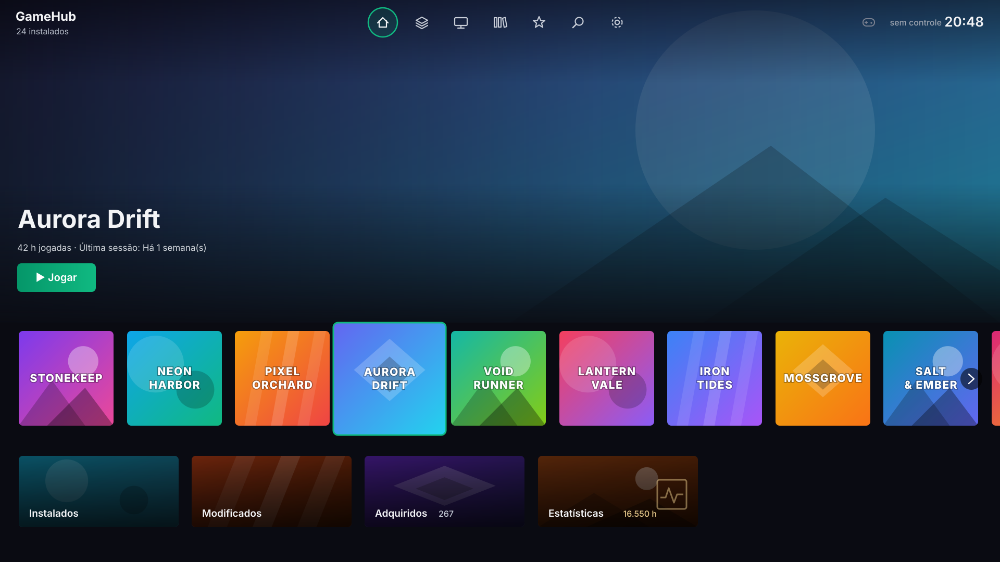
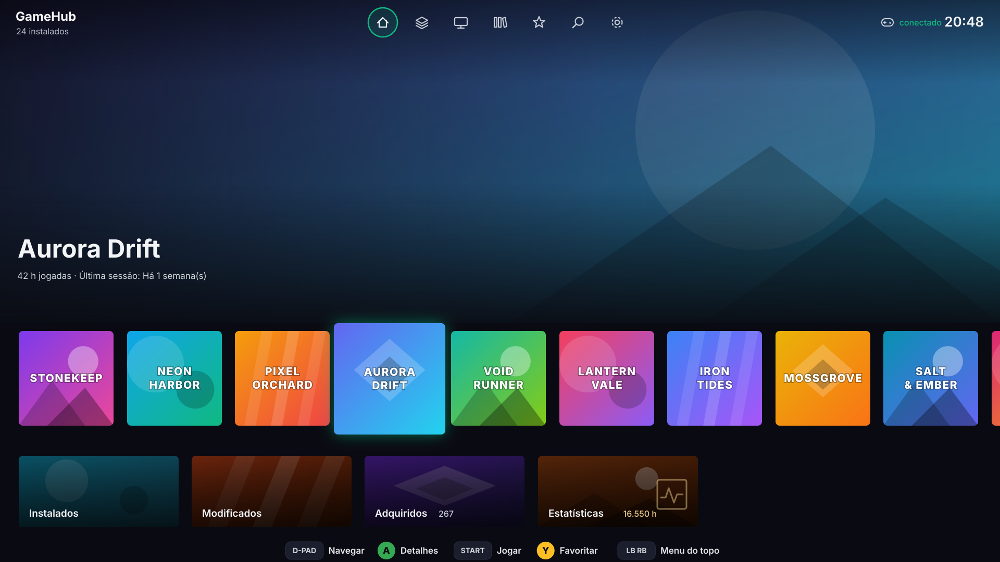
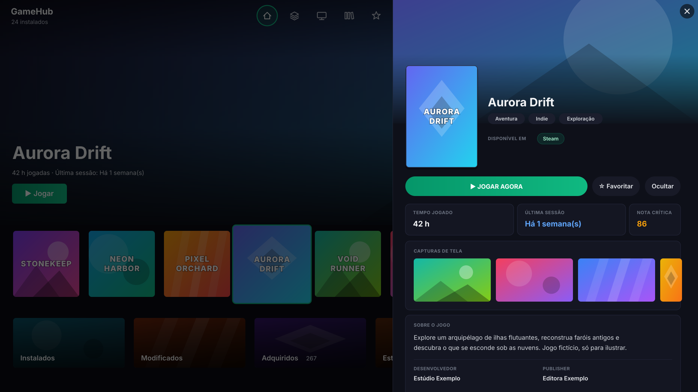
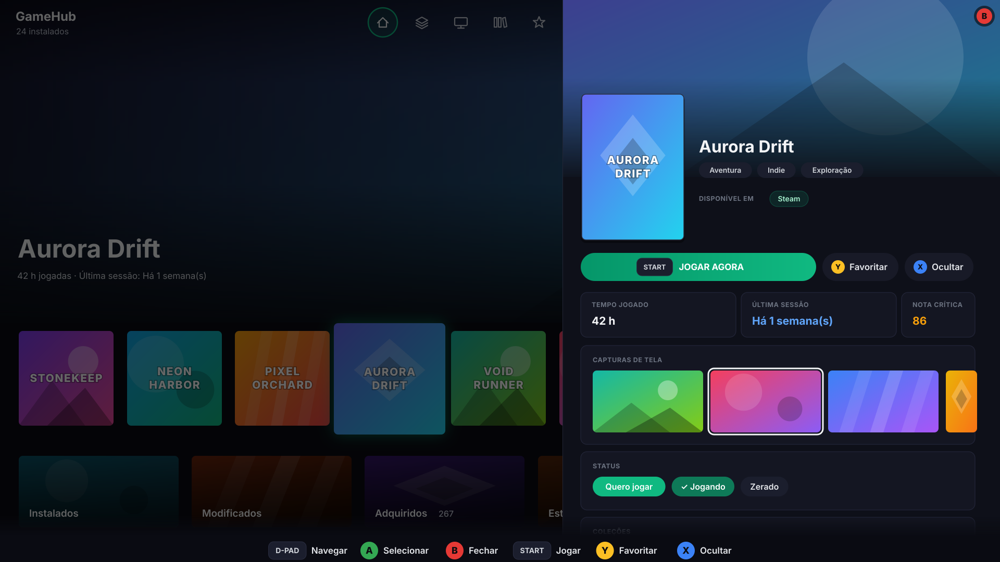
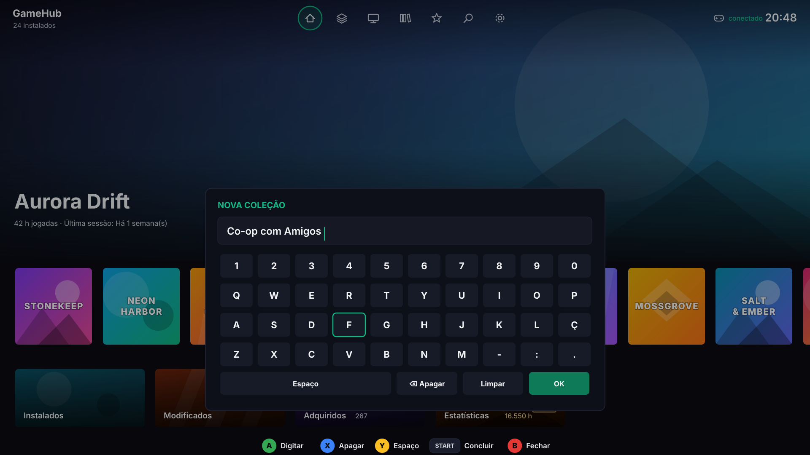

# GameHub

Launcher pessoal que reúne os jogos de várias lojas e emuladores em uma única tela, com navegação por controle e experiência de console. Feito em **C# / WPF (.NET 10)** para Windows.

> Projeto pessoal de portfólio, feito para uso próprio e aberto para quem quiser ler, usar ou aprender com o código. Interface e comentários em português do Brasil.
>
> **Não é afiliado à Valve/Steam, Epic Games, GOG/CD Projekt, Electronic Arts, Ubisoft nem a nenhum emulador.** Os nomes e logos das lojas pertencem aos seus donos e aparecem só para identificar cada loja. Veja [Limitações e avisos](#limitações-e-avisos) antes de usar.

## Telas

> Ilustrações esquemáticas do layout, com jogos fictícios. Não são capturas da minha biblioteca: o repositório não contém arte de jogos de terceiros.

### Início

| Mouse e teclado | Controle |
|---|---|
|  |  |

### Detalhes do jogo

| Mouse e teclado | Controle |
|---|---|
|  |  |

No modo controle somem os itens que exigem mouse ou teclado (adicionar jogo/ROM, lixeiras, links), os botões ganham o ícone do controle e o detalhe inteiro é navegável pelo direcional.

### Teclado virtual (modo controle)



## O que ele faz

- **Biblioteca unificada**: Steam, Epic Games, GOG, EA App e Ubisoft Connect na mesma lista. O mesmo jogo em mais de uma loja vira um único card (na Steam, a junção é pelo AppId, então renomeações da loja não duplicam o jogo).
- **Tela Início estilo console**: o jogo em foco ocupa a tela com o plano de fundo dele, nome, tempo jogado e última sessão. Embaixo, uma fileira com até 30 jogos (os jogados recentemente primeiro) e o card "Ver todos".
- **Planos de fundo por jogo**, automáticos e sem trabalho manual na maioria dos casos (veja a seção abaixo).
- **Barra do topo**: Início, Plataformas, Emuladores, Coleções, Favoritos, Buscar e Ajustes. Plataformas, Emuladores e Coleções abrem chips que filtram a fileira da Início (por loja, por console ou por coleção) e quebram linha quando há muitos.
- **Atalhos na Início**: Instalados, Modificados, Adquiridos e Estatísticas, cada um com a sua tela ou painel.
- **Coleções próprias**: agrupe jogos como quiser (ex.: uma franquia). Botão direito no card marca ou desmarca o jogo em uma coleção ou cria uma nova; botão direito no chip da coleção renomeia ou exclui. Uma coleção pode misturar jogos de loja, emuladores e modificados. Os três status (Quero jogar, Jogando, Zerado) são coleções reservadas com esses nomes, então também aparecem como filtro no ícone Coleções.
- **Estatísticas**: painel com os 10 jogos mais jogados e as horas de cada loja (cada loja soma só o que foi jogado nela).
- **Detalhes do jogo**: painel com a faixa de fundo do jogo, capa, ações (jogar, favoritar, ocultar), tempo jogado, última sessão, nota da crítica, descrição, desenvolvedora e editora, e opções para personalizar capa, fundo e arte do card. Também tem o **status do jogo** (Quero jogar, Jogando ou Zerado), as **coleções** em que ele está e um botão para editá-las. Também mostra, vindos da loja da Steam: **galeria de capturas de tela** (clicar abre a imagem grande no meio da tela; clicar fora, Esc ou B fecha; ‹ › trocam de imagem), **links rápidos** (Loja Steam, site oficial, PCGamingWiki e HowLongToBeat) e um card de **requisitos mínimos/recomendados** com o idioma português. Jogos de outras lojas só recebem esses dados se a Steam tiver um jogo com exatamente o mesmo nome; ROMs e jogos modificados mostram só os links.
- **Atalhos de pasta** no botão direito do card: abrir a pasta do jogo, do emulador ou mostrar a ROM no Explorer, e copiar o caminho.
- **Pesquisa**: na Início procura em todos os jogos (instalados, adquiridos, emuladores e modificados); a tela Instalados filtra só os instalados. Clicar fora da barra a fecha, mantendo o filtro (a lupa fica acesa). Entende **siglas e apelidos**: `gta5`, `rdr2`, `tlou` (iniciais do título) e `fifa` (EA FC), `cod`, `bf4`, `cs2`, `re`, `ff` (lista própria). Quando o texto é um apelido conhecido, só os jogos dele aparecem; os seus apelidos vão em `%AppData%\GameHub\search_aliases.json`.
- **Duplicados**: em Ajustes > Duplicados, o app sugere pares de jogos de lojas diferentes com nomes parecidos para você juntar em um card só, ou marcar como diferentes.
- **Arte nos cards de consoles e atalhos**: cada card mostra a arte de um jogo, sorteado a cada abertura, ou um jogo que você fixa (botão "Usar como arte do card" no painel de detalhes ou menu do botão direito no card).
- **Instalados e adquiridos**: telas separadas. Instalados mostra só jogos de loja instalados; Adquiridos mostra o que você possui e não instalou (a partir do banco do GOG Galaxy e da conta).
- **Emuladores**: jogos agrupados por console, configurados por `emulators.json`. Escolher um console no topo filtra a Início; "Ver todos" abre a grade daquele console.
- **Jogos modificados**: tela para jogos adicionados manualmente (executável, capa e argumentos próprios).
- **Favoritos e ocultos**, e ordenação por nome, último jogado ou mais jogado.
- **Tempo de jogo e última sessão** por loja, sem somar entre plataformas (contas diferentes não compartilham save).
- **Capas** em cache local, com miniaturas pré-geradas para abrir rápido.
- **Modo controle**: navegação completa por controle XInput, barra de dicas dos botões, sons de navegação e **teclado virtual** para pesquisar e para nomear coleções. Itens que dependem de mouse ou teclado (adicionar jogo ou ROM, atualizar, lixeiras dos cards, Duplicados, links e personalização no detalhe) ficam escondidos, e os botões mostram o ícone do botão do controle (B, Y, X, START). No detalhe do jogo o controle navega pelas capturas, pelo status e pelas coleções, e rola o painel. O mouse e o controle trocam sozinhos de modo conforme o que você usa.
- **Camada "Iniciando"** dentro da própria janela ao abrir um jogo, no lugar de uma janela separada.
- **Atualização automática**: a biblioteca é refeita em segundo plano ao voltar para a janela.
- **Avisos dentro do programa** (por exemplo, ao terminar de buscar fundos), barra de rolagem, tooltips e menus escuros no estilo do app. Transições curtas ao trocar de tela e sons na Início.
- **Janela lembrada**: tamanho, posição e estado maximizado voltam como você deixou (com proteção para nunca abrir fora da tela).

## Planos de fundo

Cada jogo procura o fundo nesta ordem, parando no primeiro que achar:

1. **Manual**: botão "Trocar fundo" no painel de detalhes (aceita imagens grandes, até 3840 px de largura).
2. **Steam, cache local**: arte da própria biblioteca da Steam.
3. **Steam, CDN**: arte oficial baixada para jogos da Steam.
4. **[SteamGridDB](https://www.steamgriddb.com/)**: por AppId (jogos da Steam) ou pelo nome limpo do jogo (ROMs, GOG, Epic, EA, Ubisoft). Só aceita um resultado de nome igual ou que comece igual, para nunca mostrar arte de outro jogo.
5. **Degradê** com a cor média da capa.

Tudo o que é baixado fica em cache em `%AppData%\GameHub\Backgrounds`. Com a chave configurada, o app baixa **sozinho e em segundo plano** o fundo de jogos novos sempre que a biblioteca muda. Em **Ajustes > Buscar fundos**, ele força a busca de toda a biblioteca de uma vez (com progresso; um segundo clique cancela).

### Chave do SteamGridDB

O SteamGridDB precisa de uma chave gratuita (steamgriddb.com, nas preferências do perfil, aba API). Ela fica **só no seu PC**, fora do repositório:

```powershell
New-Item -ItemType Directory -Force "$env:APPDATA\GameHub" | Out-Null
@{ SteamGridDbKey = "SUA_CHAVE" } | ConvertTo-Json | Set-Content "$env:APPDATA\GameHub\secrets.json" -Encoding UTF8
```

Sem a chave, tudo funciona normalmente; só não há fundos baixados do SteamGridDB.

## Controles

| Controle | Ação |
|---|---|
| Direcional / analógico esquerdo | Navegar |
| A | Confirmar / abrir detalhes; no detalhe, abre a captura, marca o status ou abre as coleções |
| B | Voltar: fecha a captura, o seletor, o painel ou a barra aberta, limpa a pesquisa, tira o filtro da Início e volta para a Início |
| Y | Favoritar |
| X | Ocultar (com o painel de detalhes aberto) |
| LB / RB | Anda só pelos ícones do topo |
| Start | Jogar |

**Teclado virtual**: A na lupa do topo abre o teclado. D-pad escolhe a tecla e A digita; X apaga, Y põe um espaço, Start (ou a tecla OK) conclui e B fecha. A lista filtra enquanto você digita. O mesmo teclado serve para dar nome a uma coleção nova (no seletor de coleções do detalhe): a primeira letra de cada palavra sai maiúscula e Start ou OK confirma.

Teclado e mouse: digitar em qualquer lugar abre a busca, `F11` alterna tela cheia, `Esc` fecha a camada de lançamento, `Ctrl+M` liga/desliga os sons. Com o mouse, a Início tem setas para rolar a fileira e o botão grande "Jogar"; no controle esse botão some, porque o Start joga.

## Como cada loja é lida

| Loja | Fonte dos jogos instalados | Tempo de jogo / última sessão |
|---|---|---|
| Steam | `appmanifest_*.acf` das bibliotecas | `localconfig.vdf` da conta (arquivo local da Steam) |
| Epic Games | Manifestos do launcher, ou pastas `.egstore` nos discos (funciona sem o launcher) | Só o que o GOG Galaxy tiver sincronizado |
| GOG | Registro do Windows | Banco do GOG Galaxy, quando o jogo é conhecido por ele |
| EA App | Registro (só conta se existem arquivos do jogo no disco) | Banco do GOG Galaxy, se o plugin de EA estiver ativo nele |
| Ubisoft Connect | Registro | Só o que o GOG Galaxy tiver sincronizado |

Jogos de **emulador** e **modificados** têm o tempo medido pelo próprio GameHub (ele observa o processo do jogo). Para as outras lojas, o GameHub **nunca estima**: mostra só o que a loja ou o GOG Galaxy realmente registrou. Quando duas chaves da mesma loja são o mesmo jogo (por exemplo, edições da EA), fica o maior tempo, sem somar.

Os jogos "adquiridos" e parte dos metadados (descrição, gêneros, nota) vêm do banco do **GOG Galaxy** (`galaxy-2.0.db`), lido em cópia temporária e somente leitura. Se uma loja não aparece completa, confira se a integração dela está ativa no Galaxy (Configurações > Integrações): o GameHub mostra o que o Galaxy tem.

## Requisitos

- Windows 10 ou 11
- [.NET 10 SDK](https://dotnet.microsoft.com/download) (para compilar) ou o runtime .NET 10 Desktop (para rodar)
- Opcional: controle compatível com XInput (Xbox, 8BitDo Ultimate 2C etc.)
- Opcional: chave gratuita do SteamGridDB, para os fundos automáticos

## Como compilar e executar

```bash
git clone https://github.com/destart31/GameHub.git
cd GameHub
dotnet run
```

Se o build acusar arquivos `obj` ausentes, apague as pastas `bin` e `obj` e compile de novo. Evite deixar o projeto em pastas sincronizadas por nuvem (OneDrive, por exemplo): elas podem travar arquivos temporários do build.

### Publicar como executável único

```bash
dotnet publish -c Release -r win-x64 --self-contained false -p:PublishSingleFile=true -o publish
```

Gera um `GameHub.exe` que depende do runtime .NET 10 Desktop instalado. Arquivos de conteúdo, como `emulators.json`, ficam ao lado do executável; os dados do usuário continuam em `%AppData%\GameHub`. O resultado fica na pasta `publish` (já ignorada pelo git). Publique fora de pastas sincronizadas.

## Estrutura do projeto

```
GameHub/
├─ Models/        GameEntry (jogo e dados pessoais), PlatformStyle
├─ Scanners/      Um scanner por loja + emuladores + GogGalaxyDbScanner
├─ Services/      Lógica de biblioteca, capas, fundos, controle, dados do usuário
├─ Assets/        Ícones das lojas
├─ MainWindow.xaml(.cs)   Janela principal: topo, Início, listas, detalhes, barra de dicas, camada de lançamento
├─ emulators.json         Consoles e emuladores configurados
└─ App.xaml(.cs)          Inicialização e tratamento global de erros
```

Principais serviços:

- `GameLibraryService`: carrega todos os scanners, junta os jogos da Steam pelo AppId, agrupa o resto por título e funde as plataformas de cada jogo.
- `LibraryCacheService`: guarda a última biblioteca para abrir na hora; a varredura real roda por trás e só troca a tela se algo mudou.
- `BackgroundService`: planos de fundo por jogo (manual, Steam, SteamGridDB, degradê), com cache em disco e busca em lote.
- `CardArtService`: guarda qual jogo você fixou como arte de cada card (consoles e atalhos).
- `CollectionsService`: coleções próprias (nome e jogos de cada uma).
- `SearchAliasService`: pesquisa por texto, siglas (iniciais do título) e apelidos, com lista própria e arquivo do usuário.
- `GameDetailsService`: capturas, requisitos, idiomas e site oficial da loja pública da Steam, com cache em disco (30 dias; 14 quando o jogo não foi achado).
- `TitleAliasService`: equivalências de nomes entre lojas, usadas para agrupar o mesmo jogo e para sugerir duplicados.
- `WindowStateService`: salva e restaura tamanho, posição e estado da janela.
- `SteamLocalStatsService`: horas e última sessão da Steam.
- `PlaySessionService`: mede o tempo de emuladores e jogos modificados.
- `UserDataService` e `UiStateService`: favoritos, ocultos, último lançamento, aba e ordenação.
- `CoverService`: capas locais, miniaturas, cache do Galaxy e download das que faltam.
- `ControllerService`: leitura do controle por XInput (funciona mesmo com a janela sem foco; por isso todo comando passa por uma guarda que ignora o controle quando o GameHub não está ativo).
- `NavSounds`: sons curtos gerados em código, sem arquivos de áudio.
- `GameLauncher`: abre o jogo por protocolo da loja ou executável (a Steam é iniciada em modo silencioso).

## Dados do usuário

Tudo fica em `%AppData%\GameHub`, fora da pasta do programa:

| Arquivo | Conteúdo |
|---|---|
| `secrets.json` | Chave do SteamGridDB (nunca vai para o repositório) |
| `custom_games.json` | Jogos modificados adicionados |
| `user_data.json` | Favoritos, ocultos e último lançamento |
| `play_sessions.json` | Tempo medido de emuladores e modificados |
| `ui_state.json` | Aba e ordenação da última vez |
| `card_art.json` | Jogos fixados como arte dos cards |
| `collections.json` | Suas coleções e os jogos de cada uma |
| `title_aliases.json` / `title_ignored.json` | Jogos que você juntou ou marcou como diferentes em Duplicados |
| `window_state.json` | Tamanho, posição e estado da janela |
| `library_cache.json` | Cache da biblioteca |
| `Covers\` | Capas e miniaturas (`Covers\thumbs`) |
| `search_aliases.json` | (opcional) Seus apelidos de pesquisa: `{ "w3": ["witcher 3"] }` |
| `Details\` | Cache dos detalhes da Steam (capturas, requisitos, idiomas) por jogo |
| `Backgrounds\` | Fundos: `m_*` manuais, `s_*` da Steam, `a_*.img` do SteamGridDB (`a_*.none` marca o que não foi encontrado, com nova tentativa em 14 dias) |
| `sound_off.flag` | Existe quando os sons estão desligados |

Logs de diagnóstico no mesmo lugar: `errors.log`, `startup_log.txt`, `ea_scan_log.txt`, `epic_scan_log.txt`, `steam_stats_log.txt`, `playtime_log.txt`.

## Decisões de projeto

- **Desempenho antes de efeito visual**: nada de blur ou sombras na janela inteira (derrubavam a GPU). Animações finitas e com taxa de quadros limitada. Os fundos usam imagem esmaecida por máscara, sem efeito de desfoque.
- **Nunca inventar dados**: sem tempo de jogo local, aparece "Nunca jogado" em vez de uma estimativa. Sem imagem confiável para um jogo, ele fica com o degradê em vez de uma arte errada.
- **Segredos fora do git**: a chave do SteamGridDB vive em `%AppData%`, nunca no projeto.
- **Leitura tolerante**: arquivos de outros programas são abertos com `FileShare.ReadWrite` e qualquer falha de leitura é contida.
- **Gravação atômica**: todo JSON e toda imagem baixada é escrita em `.tmp` e trocada de uma vez.
- **Sem backup de saves**: Steam, Epic, GOG, EA e Ubisoft já guardam os saves na nuvem e os emuladores têm os próprios, então o GameHub não duplica isso.
- **Erros não derrubam o programa**: um tratamento global registra no `errors.log` e mantém o GameHub aberto; erros em sequência fecham com aviso.

## Limitações e avisos

Este é um projeto pessoal; funciona bem no PC em que foi feito, mas **não foi testado como produto**.

- **Só Windows** (WPF, .NET 10), desenvolvido e testado em um único PC. Os ícones da interface usam a fonte Segoe Fluent Icons, que no Windows 10 pode não existir.
- **Depende do GOG Galaxy** para os jogos "adquiridos" e para o tempo de jogo da Epic, EA App e Ubisoft: o GameHub lê o banco local do Galaxy (`galaxy-2.0.db`), que é interno, não documentado e pode mudar sem aviso. Sem o Galaxy (ou sem as integrações ativas nele), os jogos instalados continuam aparecendo, mas a lista de adquiridos e as horas de Epic, EA e Ubisoft podem faltar.
- **Rotas não oficiais da loja da Steam**: capturas, requisitos, descrição e busca por nome usam endereços públicos da loja (`appdetails`, `storesearch`) que não são documentados e podem parar de funcionar. Quando falham, a tela só deixa de mostrar esses dados.
- **Emuladores**: a configuração (`emulators.json`) espera uma pasta base no layout do RetroBat/Playbox (`roms\<console>` e `emulators\<emulador>`) e começa vazia, com os emuladores desligados. O GameHub não inclui emuladores, ROMs nem jogos.
- **Idioma**: a interface está só em português do Brasil.
- **Sem instalador**: não há instalador, atualização automática nem assinatura digital; o Windows pode mostrar um aviso ao abrir um executável gerado por você.
- **Arte de jogos**: capas e fundos são baixados na sua máquina, a partir das lojas, do SteamGridDB e de repositórios públicos, e ficam só em cache local. Nada disso vem no repositório.
- Os logos das lojas em `Assets\Icons` são marcas registradas dos seus donos.

### Privacidade e rede

Tudo fica no seu computador, em `%AppData%\GameHub`. Não há telemetria, conta nem envio de dados seus. O programa só faz estas consultas de saída, todas públicas:

| Para quê | Onde |
|---|---|
| Descrição, gêneros, nota, capturas, requisitos e idiomas | Loja da Steam (`store.steampowered.com`) |
| Capas e fundos da Steam | CDNs da Steam |
| Fundos automáticos (opcional, precisa da sua chave) | SteamGridDB |
| Capas de ROMs | `libretro-thumbnails` e `xlenore/ps2-covers` (GitHub) |

Os links "PCGamingWiki" e "HowLongToBeat" só abrem o navegador. Os arquivos de log (`errors.log` e outros) podem conter caminhos de pastas do seu PC: não os publique sem conferir.

### Outras limitações conhecidas

- O nível de bateria do controle só aparece quando o Windows o informa: receptores 2.4G como o do 8BitDo Ultimate 2C se apresentam como "com fio", e aí o app mostra apenas "conectado".
- Epic, EA App e Ubisoft não guardam o tempo localmente: o GameHub depende do GOG Galaxy e do plugin de cada loja. Sem a integração ativa no Galaxy, os jogos novos dessa loja podem faltar ou ficar sem horas.
- Renomear ou excluir uma coleção só é possível com o mouse (botão direito no chip); criar e marcar jogos funciona também pelo controle.
- Siglas de duas letras podem trazer jogos a mais (ex.: `ac` casa qualquer título cujas iniciais comecem com "ac"); apelidos conhecidos, como `cs`, mostram só os jogos certos.
- Jogos da Epic detectados só por `.egstore` usam o nome da pasta como título, então um nome de pasta diferente do oficial pode não se unir ao mesmo jogo vindo do Galaxy.
- Capturas, requisitos e idiomas dependem da loja da Steam e da internet; jogos que ela não conhece (ou conhece com outro nome) ficam só com os links.
- Fundos automáticos por nome podem às vezes mostrar uma arte de outro jogo parecido; nesse caso, use "Trocar fundo", que sempre vence o automático.
- A atualização automática acontece ao voltar para a janela; um download que termine com o GameHub em foco aparece na próxima ação.

## Ideias futuras

- Sem pendências no momento; novas ideias entram aqui.

## Licença

[MIT](LICENSE). Os nomes e logos de terceiros citados aqui pertencem aos seus respectivos donos.
